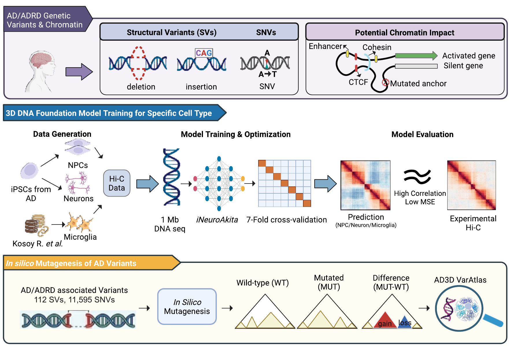

# iNeuroAkita: a neuronal and microglial fine-tuned 3D DNA model of the structural consequences of genetic variants in Alzheimer's disease

A pipeline that fine-tunes the Akita model on Hi-C data from brain cell types to predict 3D genome structure from DNA sequence. It then uses the fine-tuned model to evaluate how genetic variants change chromatin architecture.



## Overview

iNeuroAkita is a multi-target (3-head) Akita model. It predicts Hi-C contact maps (2,048 bp resolution, 1 Mb windows) in three Alzheimer's disease–relevant cell types: **NPC** (head 0, iPSC-derived neural progenitor cells), **Mic** (head 1, primary microglia) and **Neuron** (head 2, iPSC-derived neurons).

This repository provides tools and trained models for:
- **Processing and checking Hi-C data**: cooler QC, library reproducibility, depth matching
- **Training Akita models** with 7-fold chromosome-disjoint cross-validation, initialised from the published Akita weights
- **Making predictions** on held-out chromosomes and independent samples, with a base-pair-level leakage audit
- **Evaluating predictions** against Hi-C and against the original Akita model
  - smoothed correlation and MSE, distance-stratified and insulation metrics
  - noise ceiling and cell-type specificity
- **Analyzing CTCF motif mutations**: single-base saturation mutagenesis of CTCF motifs, and whole-motif perturbations
- **Analyzing SNP mutations**: 42 CRISPR-validated functional SNVs and fine-mapped microglia eQTLs
- **Analyzing structural variants (SVs)** of AD/ADRD with SuPreMo
- **Computing disruption scores** out-of-fold, each with an empirical P value against matched null variants

The seven trained fold models of the final model are included in [`models/`](models/README.md).

## Table of Contents

- [Installation](#installation)
- [Quick Start](#quick-start)
- [Data Preparation](#data-preparation)
- [Model Training](#model-training)
- [Pre-trained Models](#pre-trained-models)
- [Prediction](#prediction)
- [Evaluation](#evaluation)
- [Variant Scoring Setup](#variant-scoring-setup)
- [CTCF Mutagenesis Analysis](#ctcf-mutagenesis-analysis)
- [SNP Mutagenesis Analysis](#snp-mutagenesis-analysis)
- [SV Mutagenesis Analysis](#sv-mutagenesis-analysis)
- [Project Structure](#project-structure)
- [Requirements](#requirements)
- [Acknowledgments](#acknowledgments)
- [Citation](#citation)
- [License](#license)

## Installation

### Prerequisites

- Python 3.8
- Mamba or Conda
- CUDA-capable GPU (recommended for training and prediction; the variant analyses run on CPU)

### Environment Setup

```bash
git clone <this repository> iNeuroAkita && cd iNeuroAkita

# 1. training / prediction / evaluation / analysis environment
mamba env create -f environment/iNeuroAkita_env.yml
conda activate ineuroakita

# basenji provides akita_data.py and akita_train.py
git clone https://github.com/calico/basenji.git
pip install -e basenji

# 2. SuPreMo with the iNeuroAkita multi-head patch (variant scoring; separate environment)
git clone https://github.com/ketringjoni/SuPreMo.git variant_scoring/SuPreMo
cd variant_scoring/SuPreMo
git checkout 9799281
git apply ../../supremo_patch/SuPreMo_A4.patch
mamba env create -f supremo_env.yml
cd ../..
export SUPREMO_DIR=$PWD/variant_scoring/SuPreMo
```

## Quick Start

1. **Use the trained models** in `models/` (see [Pre-trained Models](#pre-trained-models)), or prepare your data ([Data Preparation](#data-preparation)) and train your own ([Model Training](#model-training)).
2. **Make predictions** on held-out or new data ([Prediction](#prediction)).
3. **Evaluate results** ([Evaluation](#evaluation)).
4. **Score variants** out-of-fold: CTCF motifs, SNPs and SVs ([Variant Scoring Setup](#variant-scoring-setup)).

All scripts print their options with `-h`. Scripts within a folder are numbered in the order they are run.

## Data Preparation

### 1. Process Hi-C Data

Process Hi-C FASTQ data into `.cool` format with the [distiller-nf pipeline](https://github.com/open2c/distiller-nf):
- reference: hg38 without ALT contigs (BWA)
- filter: MAPQ ≥ 30
- resolution: 2,048 bp
- balancing: ICE

Check the coolers before training:

```bash
python scripts/01_hic_qc/qc_coolers.py \
  --cool NPC_P16=coolers/NPC_P16.hg38.mapq_30.2048.cool \
  --cool Mic_AD=coolers/Mic_AD.hg38.mapq_30.2048.cool \
  --cool Neuron_P16=coolers/Neuron_P16.hg38.mapq_30.2048.cool
```

| script | purpose |
|---|---|
| `qc_coolers.py` | balancing weights, cis/trans and long-range cis coverage, depth comparability across cell types |
| `library_reproducibility.py` | agreement between the libraries of one cell type |
| `compare_hic_stats.py` | side-by-side comparison of pairtools `.stats` files |
| `downsample_cool.py` | binomial thinning of a cooler to a target depth (used for the replicate noise ceiling) |

### 2. Prepare Target Cooler File

Create a target table (`configs/cool_targets.txt`). Its row order defines the head order of the model:

```
index	identifier	file	clip	sum_stat	description
0	NPC_P16	coolers/NPC_P16.hg38.mapq_30.2048.cool	2	sum	NPC_P16
1	Mic_AD	coolers/Mic_AD.hg38.mapq_30.2048.cool	2	sum	Mic_AD
2	Neuron_P16	coolers/Neuron_P16.hg38.mapq_30.2048.cool	2	sum	Neuron_P16
```

### 3. Generate Input Data for Akita

Use basenji's `akita_data.py` to build one dataset per fold. The test and validation chromosomes of the 7 folds are in `configs/folds.tsv`. Example for fold 1:

```bash
akita_data.py \
  -g ref_data/hg38_gaps_binsize2048_numconseq10.bed \
  -b ref_data/hg38-blacklist.v2_processed.bed \
  --limit configs/primary_chroms.bed \
  -l 1048576 -d 2 --crop 65536 -w 2048 --snap 2048 -k 1 \
  --as_obsexp \
  --stride_train 262144 --stride_test 1048576 \
  -t chr10,chr17 -v chr8,chr9 \
  --local -p 8 --seed 44 \
  ref_data/hg38.fa \
  configs/cool_targets.txt \
  -o model_input/fold1
```

**Parameters:**
- `-g`: gaps BED file
- `-b`: blacklist BED file
- `--limit`: restrict to the primary chromosomes (chr1–22, chrX)
- `-l`: sequence length (1,048,576 bp)
- `-d`: diagonal offset (2 bins)
- `--crop`: crop on each side, in bp (32 bins)
- `-w` / `--snap`: bin size in bp (2,048)
- `--as_obsexp`: targets as log(observed / expected)
- `-t` / `-v`: test / validation chromosomes (from `configs/folds.tsv`)
- `--stride_train` / `--stride_test`: window strides
- `-p`: number of parallel processes
- `-o`: output directory

**Helper scripts** (`scripts/02_dataset/`):
- `check_tfrecord.py model_input/fold1`: prints one batch, as a sanity check.
- `pool_data.py`: pools the train/valid/test splits of an independent sample (another donor or iPSC line, generated with the same command) into a single `all` split, used for evaluation only.

## Model Training

The 3-head model is initialised from the published 5-head Akita model, keeping every layer except the final dense layer:

```bash
python scripts/03_training/init_from_akita.py \
  --my_params configs/params_iNeuroAkita.json \
  --pre_params akita/params.json \
  --pre_weights akita/model_best.h5 \
  --out akita/init_3head.h5
```

Train one model per fold:

```bash
export PYTHONHASHSEED=42
akita_train.py -k \
  --restore akita/init_3head.h5 \
  configs/params_iNeuroAkita.json \
  model_input/fold1 \
  -o model_trainOut/NPC_Mic_Neuron_out_trunk/fold1        # repeat for fold1 ... fold7
```

**Parameters:**
- `-k`: keep existing model checkpoints
- `--restore`: initial weights (from `init_from_akita.py`)
- `configs/params_iNeuroAkita.json`: model and training configuration
  - SGD, learning rate 0.0065, momentum 0.99575, batch size 4, clip norm 2.0, patience 20
  - augmentation: reverse complement and ±11 bp shifts
- `model_input/fold1`: input data directory
- `-o`: output directory

Each run saves `params.json` and `model_best.h5`.

Model labels used in the evaluation scripts:

| label | model |
|---|---|
| A0 | original Akita, zero-shot (best head chosen on the validation chromosomes) |
| A1 / A2 | single-head models, trained from scratch / Akita-initialised |
| A3 / A4 | 3-head models, trained from scratch / Akita-initialised (**A4 = iNeuroAkita, final model**) |

## Pre-trained Models

`models/fold1` … `models/fold7` contain the final model (A4). Each folder has:
- `model_best.h5`, `params.json`
- `targets.txt`, `statistics.json`
- `split_chroms.txt` (window counts per split and chromosome)

To score a sequence or variant without train/test leakage, use the fold model whose **test** set contains its chromosome (`models/chrom_to_fold.tsv`).

```python
import json
from basenji import seqnn
params = json.load(open("models/fold1/params.json"))
model = seqnn.SeqNN(params["model"])
model.restore("models/fold1/model_best.h5")
```

Input and output:
- **Input:** 1,048,576 bp of one-hot DNA (hg38)
- **Output:** the upper triangle (diagonal offset 2) of a 448 × 448 map, i.e. 99,681 values × 3 heads, as log(observed / expected)

Details: [`models/README.md`](models/README.md).

## Prediction

`akita_predict.py` runs prediction batch by batch and pairs each model head with an observed target explicitly. It also writes per-window metrics, and can check at base-pair level that no test window overlaps a training window.

```bash
cd scripts/04_evaluation

# held-out chromosomes of fold 1
python akita_predict.py \
  --model_dir ../../models/fold1 \
  --model_targets ../../configs/cool_targets.txt \
  --data_dirs ../../model_input/fold1 --splits test \
  --output_dir out/fold1/hold_test --file_prefix fold1_test \
  --train_data ../../model_input/fold1 --strict_leakage --save_all_heads

# independent sample (e.g. another neuron line), all windows, scored against the Neuron head
python akita_predict.py \
  --model_dir ../../models/fold1 \
  --model_targets ../../configs/cool_targets.txt \
  --data_dirs ../../independent/neuron_P35/all --splits all \
  --output_dir out/fold1/indep_neuron --file_prefix neuron_all \
  --pair Neuron_P35=Neuron_P16 --train_data ../../model_input/fold1
```

**Parameters:**
- `--model_dir`: directory with `params.json` and the weights (`--model_file`, default `model_best.h5`)
- `--model_targets`: target table that defines the model head order
- `--data_dirs`: one or more `akita_data.py` datasets
- `--splits`: `train`, `valid`, `test` or `all`
- `--pair OBS=HEAD`: score an observed target against a named head; repeatable, required when the two tables differ
- `--train_data` / `--strict_leakage`: leakage audit against the training windows; strict mode stops if any overlap is found
- `--save_all_heads`: keep the predictions of every head
- `--sigma`: optional Gaussian smoothing
- `--batch_size`: batch size (default 2)
- `--skip_npz`: write metrics only, no maps

**Outputs:**
- `{file_prefix}_predictions_targets.npz`: predictions, targets and a region table
- `{file_prefix}_per_window_metrics.tsv`: Pearson, Spearman and MSE per window and head
- `{file_prefix}_metadata.json`
- `{file_prefix}_leakage_audit.tsv`: leakage report (with `--train_data`)

Smoothed metrics (σ = 2 bins; computed on the upper triangle with diagonal offset 2, as in training):

```bash
python add_smoothed_metrics.py --npz out/fold1/indep_neuron/neuron_all_predictions_targets.npz \
  --sigma 2 --replace --metrics-tsv out/fold1/indep_neuron/neuron_all_per_window_metrics.tsv
```

This writes `*_per_window_metrics_smooth2.tsv`, and with `--replace` `*_per_window_metrics_smooth2_asmain.tsv`. In the `_asmain` table the pearson / spearman / mse columns hold the smoothed values, so it can be passed to `akita_eval.py --metrics-tsv` and `compare_to_akita0.py` as is.

Use the same `--sigma` for iNeuroAkita and for the Akita zero-shot baseline.

## Evaluation

### Prediction Evaluation

`akita_eval.py` (with `akita_eval_utils.py`) makes the evaluation figures from a prediction npz:

```bash
python akita_eval.py \
  --npz out/fold1/hold_test/fold1_test_predictions_targets.npz \
  --metrics-tsv out/fold1/hold_test/fold1_test_per_window_metrics_smooth2_asmain.tsv \
  --out-dir out/fold1/hold_test/eval --tag fold1_test \
  --group-by chrom --sigma 2 --top-n 4 --vmin -2 --vmax 2
```

**Parameters:**
- `--npz`: prediction npz from `akita_predict.py`
- `--metrics-tsv`: reuse per-window metrics (e.g. the smoothed table) instead of recomputing them
- `--group-by`: panels by `chrom`, by `split` or `none`
- `--pair OBS=HEAD`: head pairing, if not stored in the npz
- `--only-targets`, `--chroms`, `--only-splits`: restrict the evaluation
- `--top-n`, `--map-sets`: number and kind (`best`, `median`, `worst`) of example maps
- `--region chr:start-end`: plot a specific region (repeatable); `--gene-marks-tsv` / `--gene-marks-json` add gene marks
- `--sigma`, `--vmin`, `--vmax`: smoothing and colour scale of the maps
- `--style`, `--color-mode`, `--separate-pdfs`: figure layout

**Outputs:**
- global and per-group MSE and Pearson r
- density scatter and histogram panels
- best / median / worst predicted vs observed maps
- region maps

### Comparison with Akita and Further Analyses

| script | analysis |
|---|---|
| `akita0_select_heads.py` | Akita zero-shot baseline: chooses the best of the 5 Akita heads per cell type on the validation chromosomes |
| `compare_to_akita0.py` | paired comparison of iNeuroAkita vs Akita zero-shot per fold and chromosome (`--metric`, `--test ttest/wilcoxon`) |
| `summarize_results.py` | training curves and all held-out / independent results of models A0–A4 in tables |
| `stage2_eval.py` | distance-stratified r, insulation profiles and TAD boundaries, distance-only and other-cell-type baselines |
| `insulation.py` | insulation-profile correlation of one fold model on the independent samples |
| `noise_ceiling.py` | replicate-halves noise ceiling (`dump`, then `ceiling`) |
| `crosshead_matrix.py` | every head (and every Akita head) against every observed cell type |
| `celltype_specific_diag.py`, `celltype_contrast.py`, `celltype_quadrants.py` | cell-type-specific contacts: observed vs predicted differences between cell types |

These scripts take `--base_dir` and expect this run layout:

```
model_trainOut/NPC_Mic_Neuron_out_trunk/foldK/           model_best.h5, params.json
    predictOut_v3/hold_test/                             held-out predictions (npz + per-window metrics)
    predictOut_indep/indep_{NPC,neuron,Mic}/             independent samples
model_trainOut/akita_zeroshot/{foldK/test, indep_v2_{NPC,neuron,Mic}, summary/}
```

Keep all evaluation scripts in one folder, because they import each other.

## Variant Scoring Setup

Variant effects are computed with [SuPreMo](https://github.com/ketringjoni/SuPreMo)-Akita, patched for the 3-head model (`supremo_patch/SuPreMo_A4.patch`). The patch:
- predicts once and returns every head; upstream indexes the wrong head when more than two cell types are requested
- adds the `maxabs` and `l1` scores
- reads the model from `$SUPREMO_MODEL_DIR`

The three heads keep SuPreMo's cell-type names: **`HFF` = NPC, `H1hESC` = Mic, `GM12878` = Neuron**.

**Out-of-fold scoring.** Each variant is scored by the fold model that held out its chromosome (`models/chrom_to_fold.tsv`). The prep scripts write one SuPreMo input per fold, or chunks listed in a `manifest.tsv` with their fold. Score each file with its fold model:

```bash
export SUPREMO_MODEL_DIR=models/fold1
python $SUPREMO_DIR/scripts/SuPreMo.py variant_scoring/inputs/SNV42_fold1.txt \
  --fa ref_data/hg38.fa \
  --dir variant_scoring/scores/SNV42/fold1 --file SNV42_fold1 \
  --Akita_cell_types HFF H1hESC GM12878 \
  --shift_by -1 0 1 --revcomp add_revcomp \
  --get_Akita_scores --scores mse corr maxabs l1 \
  --roi genes --roi_scales 10
# add --get_maps --get_tracks for case variants (contact maps and per-bin disruption tracks)
```

**Disruption metrics** (per head; mean over the 4 augmentations, shift −1/0/+1 and reverse complement):
- **MSE**: global disruption, the mean squared ALT − REF difference over the 448 × 448 map
- **MaxAbs**: local disruption, the largest single-pixel difference
- **1 − r**: structural change, 1 − Spearman r of the REF and ALT maps (SVs)
- **local_frac, local_mse, local_dcorr**: disruption within ±51 kb of the variant or breakpoint, from SuPreMo tracks

Significance is an empirical P value against matched null variants scored with the same model and settings, with BH-FDR within each set.

## CTCF Mutagenesis Analysis

Each base of a CTCF motif is changed to the three other bases, and the predicted disruption is related to the motif's position weight matrix and to CTCF binding (`scripts/06_ctcf_mutagenesis/`).

### 1. Select Sites and Build the Saturation Screen

```bash
python 01_prep_ctcf_sat.py --base . --fa ref_data/hg38.fa \
  --fimo_bed ref_data/CTCF_motif/fimo_out/fimo_qval0.05.bed \
  --meme ref_data/CTCF_motif/JASPAR2024_CTCF9.meme --motif MA0139.1
```

**Site classes**, defined by NPC CTCF ChIP-seq signal around FIMO hits of JASPAR MA0139.1:

| class | default number (option) | definition |
|---|---|---|
| strong | 150 (`--n_strong`) | bound sites in the top 20% of ChIP signal |
| weak | 75 (`--n_weak`) | bound (signal ≥ `--bound_min`) but at or below the median signal |
| unbound | 75 (`--n_unbound`) | motif present, signal < `--unbound_max` |
| control | 50 (`--n_ctrl`) | motif-free 19-bp windows near strong sites |

Sites are on autosomes, at least `--min_gap` apart and at least 600 kb from chromosome ends.

**Outputs** (`variant_scoring/inputs/CTCF_sat/`):
- `sites.tsv`
- `ctcf_sat_master.tsv`: one row per base change, with motif position, PWM log-odds of REF and ALT, ΔLLR and information content
- `chunks/`
- `manifest.tsv`

### 2. Score and Analyze

Score every chunk with SuPreMo, using its fold model, into `scores/CTCF_sat/<chunk>/`. Then run:

```bash
python 02_ctcf_sat_analysis.py --base .
```

**Outputs** (`variant_scoring/compare/CTCF_sat/`):
- `ctcf_sat_scores.tsv`, `position_summary.tsv`, `site_summary.tsv`, `stats.txt`
- figures (per head):
  - disruption per motif position compared with information content
  - ΔLLR vs disruption
  - disruption per site class
  - ChIP signal vs disruption

### 3. Case Loci with Contact Maps

```bash
python 03_prep_ctcf_cases.py --base . --head NPC --n_top 5
```

- Picks the most disruptive strong sites and fixed example loci (`--old_loci`).
- For each site it chooses a core base change and a control base change, to be scored with `--get_maps`.

### 4. Robustness and Whole-Motif Perturbations

```bash
python 04_ctcf_threshold_sensitivity.py --base .   # bound vs unbound under other ChIP thresholds and covariates (OLS)
python 05_prep_ctcf_whole.py --base .              # whole-motif deletion (DEL) and scramble (SCR) of the same sites
# score inputs/CTCFwhole with SuPreMo into scores/CTCFwhole/<name>/, then
python 06_ctcf_whole_vs_single.py --base .         # whole-motif vs best single-base disruption
```

## SNP Mutagenesis Analysis

### A. Functional SNVs (`scripts/05_variant_scoring/`, `scripts/07_snv/`)

**1. Build inputs.** Assign each SNV to its fold and check the REF allele:

```bash
python scripts/05_variant_scoring/01_prep_inputs.py --base . --fa ref_data/hg38.fa
```

**Input format:**
- `SNV42_CRISPR_frVar_hg38.tsv`: `var_id, chrom, pos_hg38, ref, alt` (+ annotations)
- `SV120_ADRD_hg38.tsv`: `var_id, chrom, pos, end, ref, alt, svtype, svlen`

**Outputs:**
- `inputs/SNV42_master.tsv`
- `inputs/SNV42_fold{k}.txt`: SuPreMo input, `CHROM POS REF ALT`
- `prep_report.txt`: REF check, fold counts, dropped variants

**2. Score and merge.** Score `SNV42_fold{k}.txt` with model `fold{k}` into `scores/SNV42/fold{k}/`, then:

```bash
python scripts/05_variant_scoring/02_merge_scores.py --base .      # --aug 0: shift-0 only (sensitivity)
```

This writes `compare/SNV42_new_scores.tsv`, with MSE, MaxAbs, corr, L1 and the 10-weighted scores per head, and the augmentation noise (`*_cv`).

**3. Significance against matched null SNPs.** This needs the eQTL null SNPs from part B:

```bash
python scripts/05_variant_scoring/03_rank_select.py --base . --n_match 500   # P vs TSS-distance- and GC-matched nulls, BH-FDR
python scripts/07_snv/01_snv_matched_null.py --base . --n_match 500 1000 2000 5000   # sensitivity to the matching size
```

**4. Case SNVs with maps and tracks.**

```bash
python scripts/07_snv/02_prep_snv_cases.py --base . --head Mic --n_null 1000
# score inputs/SNVcase (--get_maps --get_tracks) and the null subset (--get_tracks)
python scripts/07_snv/03_snv_case_tables.py --base . --flank 25
python scripts/05_variant_scoring/plot_contact.py --base . --set SNVcase --var_id rs636317 --head all
```

**Outputs:**
- local metrics, with an empirical P against 1,000 null SNPs
- affected genes (TSS-bin disruption and local z)
- per-variant tables
- REF / ALT / ALT − REF contact-map figures

### B. Fine-mapped Microglia eQTLs (`scripts/08_eqtl/`)

```bash
python 01_prep_eqtl.py --base . --fa ref_data/hg38.fa --dbsnp ref_data/dbsnp155_hg38.txt --pp_target 0.1 --pp_null 0.01 --k 5
python 02_prep_eqtl_alt.py --base .          # additional ALT alleles of multi-allelic SNPs
# score inputs/eQTL/chunks and inputs/eQTL_alt/chunks with SuPreMo into scores/eQTL/ and scores/eQTL_alt/
python 03_merge_eqtl.py --base . --head Mic
```

- **Targets** are SNPs with posterior probability (PP) > `--pp_target`.
- **Null SNPs:** each target gets `--k` SNPs from the same gene with PP < `--pp_null`, matched on distance to the TSS. They sit on the same chromosome, so they are scored by the same fold model.
- **Worst-case allele:** for each SNP and head, the ALT allele with the largest MSE is kept.

**Outputs** (`compare/eQTL/`):
- `eQTL_scores.tsv`
- `eQTL_targets_stats.tsv`: empirical P, BH q, locus-matched effect
- `summary.txt`: enrichment by PP bin (Wilcoxon)
- `eQTL_disruption_vs_P.pdf`

## SV Mutagenesis Analysis

Structural variants are scored with SuPreMo, which builds the REF and ALT sequences of deletions, duplications and inversions (`scripts/09_sv/`).

### 1. Score the SVs

Build the inputs with `scripts/05_variant_scoring/01_prep_inputs.py` (`inputs/SV120_fold{k}.txt`).

Score each fold:
- scores into `scores/SV120/fold{k}/`
- maps and tracks (`--get_maps --get_tracks`) into `scores/SV120_tracks/fold{k}/`

Then run `02_merge_scores.py`.

### 2. Matched Null SVs and Significance

```bash
python 01_prep_sv_null.py --base . --fa ref_data/hg38.fa --k 30
# score inputs/SVnull/chunks with SuPreMo into scores/SVnull/<chunk>/ (and --get_tracks into scores/SVnull_tracks/)
python 02_sv_null_stats.py --base .
```

- **Matched nulls:** each real SV gets `--k` null SVs on the same chromosome, so they are scored by the same fold model. Nulls have the same type and length, comparable gene density and a scorable window, and they don't overlap real SVs.
- **P values:**
  - `p_own`: against the SV's own nulls
  - `p_pooled`: against all nulls of the same type and similar length, with BH-FDR
- **Strata:** results by SV type × size.

### 3. Gene Attribution and Local Disruption

```bash
python 03_sv_gene_tracks.py --base . --plot_head Mic   # disruption at each protein-coding TSS in the window
python 04_sv_local.py --base . --flank 25              # local vs global disruption around the breakpoints
python ../05_variant_scoring/03_rank_select.py --base . --sv_p 0.05   # final ranking and selection
python ../05_variant_scoring/plot_contact.py --base . --set SV120 --var_id <sv id> --head all
```

**Outputs:**
- `compare/null/`: `SV120_null_stats.tsv`, `SV120_strata.tsv`
- `compare/tracks/`: `SV120_gene_effects.tsv`, `SV120_top_genes.tsv`, per-SV maps with gene tracks
- `compare/sv_local/`: `SV120_local.tsv`
- `compare/selection/`: ranked tables

## Project Structure

```
.
├── README.md                          # This file
├── LICENSE
├── environment/
│   └── iNeuroAkita_env.yml            # Conda environment specification
├── configs/
│   ├── params_iNeuroAkita.json        # model + training parameters of the final model
│   ├── cool_targets.txt               # target table (head order 0/1/2)
│   ├── folds.tsv                      # test / validation chromosomes of the 7 folds
│   ├── chrom_to_fold.tsv              # chromosome -> fold that holds it out
│   └── primary_chroms.bed             # chr1-22, chrX (akita_data.py --limit)
├── models/                            # final model: 7 fold models (see models/README.md)
│   └── fold1 ... fold7/               # model_best.h5, params.json, targets.txt, statistics.json, split_chroms.txt
├── supremo_patch/
│   └── SuPreMo_A4.patch               # multi-head patch for SuPreMo
├── figures/
│   └── fig1.png                       # schematic overview
└── scripts/
    ├── 01_hic_qc/                     # Hi-C QC
    │   ├── qc_coolers.py
    │   ├── library_reproducibility.py
    │   ├── compare_hic_stats.py
    │   └── downsample_cool.py
    ├── 02_dataset/                    # training data helpers
    │   ├── check_tfrecord.py
    │   └── pool_data.py
    ├── 03_training/
    │   └── init_from_akita.py         # 3-head model from the published Akita weights
    ├── 04_evaluation/                 # prediction and evaluation
    │   ├── akita_predict.py           # main prediction pipeline
    │   ├── add_smoothed_metrics.py    # smoothed per-window metrics
    │   ├── akita_eval.py              # evaluation figures
    │   ├── akita_eval_utils.py        # evaluation utilities
    │   ├── akita0_select_heads.py     # Akita zero-shot baseline
    │   ├── compare_to_akita0.py       # iNeuroAkita vs Akita
    │   ├── summarize_results.py
    │   ├── stage2_eval.py
    │   ├── insulation.py
    │   ├── noise_ceiling.py
    │   ├── crosshead_matrix.py
    │   ├── celltype_specific_diag.py
    │   ├── celltype_contrast.py
    │   └── celltype_quadrants.py
    ├── 05_variant_scoring/            # shared variant-scoring steps
    │   ├── 01_prep_inputs.py          # SNV / SV inputs per fold
    │   ├── 02_merge_scores.py         # merge out-of-fold SuPreMo scores
    │   ├── 03_rank_select.py          # empirical P vs matched nulls, selection
    │   └── plot_contact.py            # REF / ALT / ALT-REF contact-map figures
    ├── 06_ctcf_mutagenesis/           # CTCF motif mutagenesis
    │   ├── 01_prep_ctcf_sat.py
    │   ├── 02_ctcf_sat_analysis.py
    │   ├── 03_prep_ctcf_cases.py
    │   ├── 04_ctcf_threshold_sensitivity.py
    │   ├── 05_prep_ctcf_whole.py
    │   └── 06_ctcf_whole_vs_single.py
    ├── 07_snv/                        # functional SNVs
    │   ├── 01_snv_matched_null.py
    │   ├── 02_prep_snv_cases.py
    │   └── 03_snv_case_tables.py
    ├── 08_eqtl/                       # microglia eQTLs
    │   ├── 01_prep_eqtl.py
    │   ├── 02_prep_eqtl_alt.py
    │   └── 03_merge_eqtl.py
    └── 09_sv/                         # structural variants
        ├── 01_prep_sv_null.py
        ├── 02_sv_null_stats.py
        ├── 03_sv_gene_tracks.py
        └── 04_sv_local.py
```

## Requirements

### Software Dependencies

- Python 3.8
- TensorFlow 2.13.1
- Basenji (for the Akita model; provides `akita_data.py` and `akita_train.py`)
- SuPreMo (commit `9799281`, with `supremo_patch/SuPreMo_A4.patch`)
- NumPy, Pandas, SciPy, Matplotlib, h5py
- cooler, pysam, pyBigWig, pybedtools / bedtools, adjustText, openpyxl
- distiller-nf (Hi-C processing, separate Nextflow pipeline)

See `environment/iNeuroAkita_env.yml` for the complete list of dependencies.

### Data Requirements

- **Reference genome:** hg38 FASTA without ALT contigs (indexed)
- **Hi-C:** contact maps in `.cool` format (2,048 bp, MAPQ ≥ 30, balanced)
- **BED files:**
  - Akita gaps (`hg38_gaps_binsize2048_numconseq10.bed`)
  - ENCODE blacklist v2
  - primary chromosomes (`configs/primary_chroms.bed`)
- **Akita weights** (`params.json`, `model_best.h5`) to initialise training
- **Variant analyses:**
  - GENCODE v49 basic GTF and dbSNP b155
  - JASPAR 2024 CTCF matrices with FIMO hits on hg38
  - NPC CTCF ChIP-seq (bigWig)
  - the variant tables (functional SNVs, fine-mapped microglia eQTLs, AD/ADRD SVs)
- **Hi-C data of this study:** see the Data availability section of the paper

## Acknowledgments

- [Akita model](https://github.com/calico/basenji/tree/master/manuscripts/akita) by Fudenberg G. et al.
  - Fudenberg G, Kelley DR, Pollard KS. Predicting 3D genome folding from DNA sequence with Akita. *Nat Methods*. 2020;17(11):1111-1117. doi: 10.1038/s41592-020-0958-x.
- [Basenji](https://github.com/calico/basenji) framework
- [Distiller-nf](https://github.com/open2c/distiller-nf) for Hi-C processing
- [SuPreMo](https://github.com/ketringjoni/SuPreMo) for in silico perturbation and SV mutagenesis analysis
  - Gjoni K, Pollard KS. SuPreMo: a computational tool for streamlining in silico perturbation using sequence-based predictive models. *Bioinformatics*. 2024.

## Citation

If you use iNeuroAkita, please cite: *to be added on publication.*

## License

The code in this repository is released under the license in `LICENSE`.
- Basenji and SuPreMo are third-party tools under their own licenses. Only a patch for SuPreMo is distributed here.
- The Akita weights used for initialisation come from the original publication.
